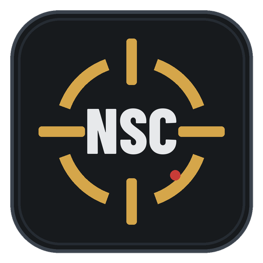
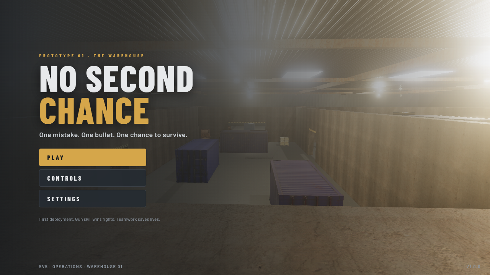

<p align="center"></p>

# NO SECOND CHANCE: 5v5 tactical FPS

One mistake. One bullet. One chance to survive.

A 5v5 tactical shooter with CS-style gunplay, a realistic injury system and teammate rescue. You get **downed, not instantly dead**: a teammate can drag you to cover and revive you, but only once per round. **Prototype 01: The Warehouse** is a full attack/defend bomb mode against bots, with realistic 3D art (see [CREDITS.md](CREDITS.md)). It runs in its own window.

## ⬇ Download (Windows)

**[Download NSC-Launcher-Setup.exe](https://github.com/piwadev/no-second-chance/releases/latest/download/NSC-Launcher-Setup.exe)**, or get it from the [latest release](https://github.com/piwadev/no-second-chance/releases/latest).

Run the installer once. It installs per user, needs no admin rights, and puts **NO SECOND CHANCE** on your desktop and in the Start menu. Press **Play**.

After that, the launcher checks GitHub Releases each time it starts and updates the game by itself. Your save is kept in `%APPDATA%\NoSecondChance\saves`, and updates never touch it.

| | |
|---|---|
|  |  |
|  |  |
|  |  |

## Features

- **Gunplay.** Hitscan weapons with fixed, learnable spray patterns, accurate first shots, and penalties for moving and jumping. Crouching helps. Recoil kick, magazine memory (a reload keeps the partial mag), tracers, decals and hit markers. Weapons: AK-74, M4, P9 service pistol and R50 heavy pistol. Grenades: frag, smoke and flashbang.
- **Injuries.** Damage is tracked per hit zone (head, chest, stomach, arms, legs), with armor and a helmet.
  - Arm hits add recoil and sway.
  - Leg hits slow you and stop sprinting.
  - Light bleeding is fixed with a bandage, heavy bleeding with a tourniquet.
  - Your state shows as Healthy, Wounded or Critical.
- **Downed, not dead.** You get a 20 s bleedout and can crawl. Teammates can drag you (hold G) and revive you with a medkit (hold E for 6 s). Each player can be rescued once per round, and enemies can finish downed players.
- **Rounds and economy.**
  - Buy phase, then 2:00 rounds.
  - The bomb takes 4 s to plant, 40 s to explode and 7 s to defuse.
  - First to 7 wins; sides swap after 6 rounds.
  - Money comes from win/loss streak bonuses and from kill, plant, defuse and rescue rewards.
- **Bots.** They navigate, take cover, use utility, plant, hold, rotate, retake, defuse and rescue teammates. Difficulty: easy, normal or hard.
- **Visuals.**
  - Rigged and animated soldiers (idle, walk, run, crouch, aim, revive, drag, downed, death) in team camo with helmets and plate carriers.
  - First-person gloved arms holding real AK, M4 and pistol models with IK.
  - A warehouse full of containers, crate stacks, pallets, steel shelving and barriers.
  - PBR materials, an HDRI environment, ACES tone mapping, soft sun shadows through roof skylights, light shafts, GTAO ambient occlusion, bloom, SMAA/FXAA and muzzle-flash lights.
  - Graphics presets: Low, Medium and High.
- **HUD.** Score, timer, bomb status, a body-injury display, team status, kill feed, radar, Tab scoreboard, round summary and buy menu.

## Controls

| Action | Key |
|---|---|
| Move / jump | `W` `A` `S` `D` / `Space` |
| Aim / fire | Mouse / `LMB` |
| Sprint (no shooting) / walk (quiet) / crouch | `Shift` / `Alt` / `C` or `Ctrl` |
| Reload | `R` |
| Rifle / pistol / last weapon | `1` / `2` / `Q` |
| Grenades (press again to cycle), throw / lob | `3` `4`, `LMB` / `RMB` |
| Plant · defuse · revive (hold) | `E` |
| Drag a downed teammate (hold) | `G` |
| Bandage / tourniquet / medkit on yourself | `X` / `V` / `H` |
| Ping, or call for help when downed | `F` |
| Buy menu / ready up | `B` / `Enter` |
| Scoreboard / pause | `Tab` / `Esc` |

## Run from source

```bash
python3 -m http.server 8080      # then open http://localhost:8080 (any static server works; ES modules need http)
cd launcher && npm install && npm start      # the desktop launcher
```

## Publishing an update

```bash
# Edit CHANGELOG.md first. The "## vX.Y.Z" section becomes the release notes shown in the launcher.
scripts/release.sh patch                 # game-only update: zip + manifest.json + sha256 on GitHub Releases
scripts/release.sh minor --launcher      # also builds and attaches a new NSC-Launcher-Setup.exe
```

[launcher/README.md](launcher/README.md) explains how the updater works.

## Tech

- Vanilla ES modules with [three.js](https://threejs.org) r187 (vendored, MIT) and no build step.
- glTF models compressed with meshopt and WebP; PBR texture sets and an HDRI from Poly Haven; rigs and animations from Quaternius. All art assets are CC0.
- Sound is synthesised with WebAudio.
- Desktop launcher: Electron and NSIS, with GitHub Releases as the update feed.
- Fonts: Barlow and Barlow Condensed (SIL OFL).
